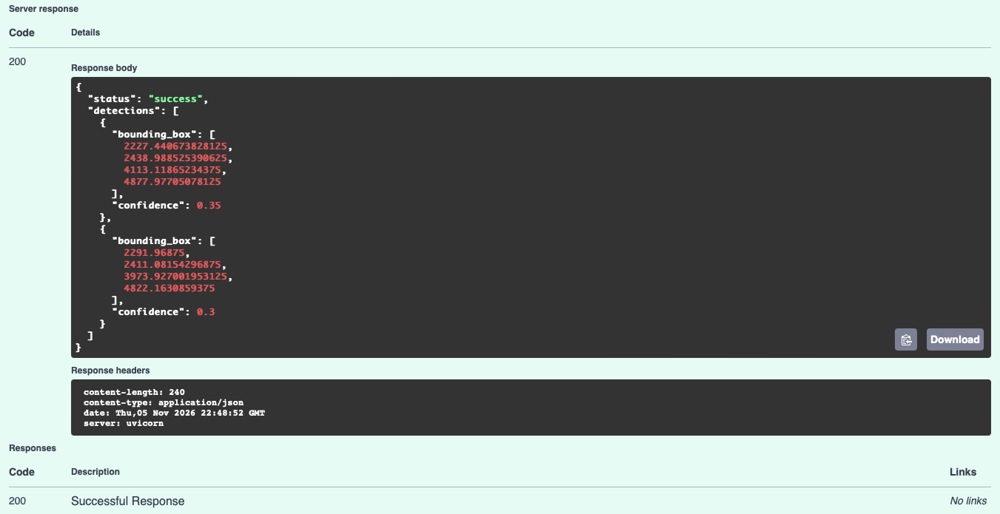

# Graduation Project Report

## 1. Introduction

The integration of computer vision into healthcare represents a major advancement for clinical diagnostics. Modern medical software harnesses automated algorithms to process intricate biological images, providing vital assistance to medical staff before complex procedures take place.

## 2. Problem Statement

Ophthalmic clinics often face workflow bottleneck during preoperative evaluations. When human eyes manually inspect retinal scans for microscopic lesions, the process is slow and prone to oversight, risking unflagged pathologies prior to surgery.

## 3. Motivation

Protecting human vision from surgical complications demands absolute precision. Ensuring that the scalpel never meets an unprepared eye makes automated, reliable secondary screening an essential safety measure for modern medicine.

## 4. Project Objective

This project aims to develop a clinical decision-support application powered by object detection algorithms. The software will automatically analyze retinal images, isolate specific anomalies, and present clear visual indicators to support clinical clearance workflows.

## 5. Preliminary Scope

- **Included in Version 1:** Core image processing logic, YOLOv8 object detection pipelines, a FastAPI backend service, and a local mock database supporting basic patient record management.
- **Excluded from Version 1:** Live interoperability protocols connecting directly to hospital Electronic Health Record systems, as well as multi-disease diagnostic modules other than diabetic retinopathy markers.

## 6. Requirements Analysis

The primary users of this system are ophthalmic surgeons and clinical triage technicians. The core problem they face is the operational bottleneck of manually screening retinal fundus images for microscopic pre-surgical contraindications[cite: 11]. The single most important result this project will deliver is a rapid, automated secondary visual assessment[cite: 11].

## 7. Functional Requirements

| ID    | Requirement statement                                                                  | Priority |
| :---- | :------------------------------------------------------------------------------------- | :------- |
| FR-01 | The system shall allow a user to upload a digital fundus image file.                   | Must     |
| FR-02 | The system shall process the uploaded image via a YOLOv8 object detection model.       | Must     |
| FR-03 | The system shall display the image with bounding boxes indicating anomalies.           | Must     |
| FR-04 | The system shall calculate and display a pre-surgical risk score based on detections.  | Should   |
| FR-05 | The system shall allow users to save the diagnostic output to a local patient profile. | Should   |

## 8. Non-Functional Requirements

| ID     | Quality     | Requirement                                                                   | How to verify                                             |
| :----- | :---------- | :---------------------------------------------------------------------------- | :-------------------------------------------------------- |
| NFR-01 | Performance | The API shall return inference results within 5 seconds of image upload.      | Measure response time with a 224x224 test image.          |
| NFR-02 | Validation  | The system shall reject non-image file uploads with a specific error message. | Attempt to upload a .pdf and verify the rejection prompt. |

## 9. Project Scope, Constraints, and Assumptions

| Category     | Question                             | Project Specification                                                      |
| :----------- | :----------------------------------- | :------------------------------------------------------------------------- |
| In scope     | What will the first version include? | Detection of diabetic retinopathy markers via bounding boxes.              |
| Out of scope | What is intentionally postponed?     | Integration with live hospital HL7/FHIR EHR networks.                      |
| Constraint   | What limits development?             | AI model must be trained in the cloud due to local hardware limits.        |
| Assumption   | What are you relying on?             | The clinical workstation has internet access to reach the FastAPI backend. |

## 10. Use Cases and User Stories

**User Story 1 (Linked to FR-03):**
As an ophthalmic surgeon, I want to view bounding boxes over retinal lesions so that I can instantly verify the AI's diagnostic reasoning.

- **Acceptance Criterion 1:** Given a processed image, bounding boxes are clearly drawn around detected anomalies.
- **Acceptance Criterion 2:** Each bounding box displays a visible confidence percentage.

**User Story 2 (Linked to FR-01):**
As a clinical screening technician, I want to upload a patient's fundus scan into the system so that it can be evaluated before the surgeon's review.

- **Acceptance Criterion 1:** When I select a valid JPEG/PNG image, the system successfully initiates the upload to the API.
- **Acceptance Criterion 2:** When the upload begins, a loading indicator appears while waiting for inference.

## 11. Development Plan

| Week   | Expected milestone in the nine-week program                                                     |
| :----- | :---------------------------------------------------------------------------------------------- |
| Week 3 | System architecture diagrams mapping the frontend to the FastAPI/YOLOv8 backend.                |
| Week 4 | First demonstrable prototype allowing image upload via API and returning a basic text response. |
| Week 5 | Integration of the trained YOLOv8 model into the API for live bounding box generation.          |
| Week 6 | Execution of validation tests comparing AI outputs against the ground-truth dataset labels.     |
| Week 7 | Finalization of UI integration with Firebase mock patient records.                              |
| Week 8 | Report completion and professional README with software installation instructions.              |
| Week 9 | Final demonstration of end-to-end image upload, API inference, and UI risk assessment.          |

## 12. Methodology and Proposed System

The proposed engineering approach utilizes a decoupled client-server architecture to provide automated pre-surgical screening for diabetic retinopathy. The system boundaries isolate the clinical user interface (Client Workstation) from the heavy AI processing (Backend Server). The primary goal is to deliver a zero-footprint web application for ophthalmic surgeons to instantly verify AI diagnostic reasoning via bounding boxes.

## 13. System Architecture

As illustrated in the system architecture diagram (Figure 3.1), the system consists of five main components. The **React Web Client** acts as the clinical interface, sending fundus image files via HTTP POST to the **FastAPI Backend Server**. The backend routes the preprocessed image tensor to the **YOLOv8 Engine** for core object detection inference. The resulting bounding box coordinates are returned to the frontend, where the **Cornerstone.js Viewer** natively draws the clinical overlays. Patient metadata is stored securely in an external **Firebase Cloud System**.

## 14. Technology Selection and Design Decisions

**ADR-01: Frontend Framework**

- **Selected Option:** React with TypeScript and Cornerstone.js.
- **Alternative Considered:** Kotlin native Android application.
- **Justification:** Hospital IT departments require "zero-footprint" web viewers that run on any clinical workstation without local software installations. Cornerstone.js provides native medical imaging tools that mobile frameworks lack.

**ADR-02: AI Inference Engine**

- **Selected Option:** YOLOv8 (Object Detection).
- **Alternative Considered:** ResNet-50 (Image Classification).
- **Justification:** Explainable AI (XAI) is a hard requirement for surgical trust. YOLOv8 provides precise bounding boxes around lesions instead of a "black box" percentage score.

## 15. Traceability and Flow

**End-to-End Data Flow:** A clinical technician uploads a `.jpg` file in the React client. The FastAPI server receives the HTTP POST request, validates it, and forwards the image tensor to YOLOv8. YOLOv8 outputs a JSON array of lesion coordinates (X, Y, Width, Height). FastAPI writes the metadata to Firebase, and forwards the JSON back to the React client where Cornerstone.js renders the final overlay.

**Design Risks:**

1. Cornerstone.js canvas integration complexity (Mitigated by testing a standalone HTML viewer first).
2. High AI inference latency (Mitigated by exporting the YOLOv8 model to the ONNX format for faster CPU execution).

## 16. Implementation Overview

This prototype implements the backend API inference engine, fulfilling functional requirement FR-02 (processing the uploaded image via a YOLOv8 object detection model). It activates the "Backend Server" boundary of the Week 3 architecture. The API receives an image payload, processes it through PyTorch/YOLOv8, and returns a JSON response containing bounding box coordinates. The React frontend and Firebase database connections are not yet supported in this iteration.

## 17. Development Environment and Technologies

| Component           | Actual technology/version   | Role and reason for selection                                               |
| :------------------ | :-------------------------- | :-------------------------------------------------------------------------- |
| Language            | Python 3.11                 | Native execution environment for deep learning libraries.                   |
| Framework/libraries | FastAPI, Ultralytics YOLOv8 | FastAPI provides rapid REST endpoints. Ultralytics provides the YOLOv8 API. |
| IDE/build tools     | VS Code, Uvicorn            | VS Code for scripting; Uvicorn as the ASGI web server.                      |
| Data/database       | Local file system (Temp)    | Images are temporarily stored in RAM (io.BytesIO) during inference.         |
| Version control     | Git and GitHub              | Development history, branching, and evidence tracking.                      |

## 18. Prototype Implementation

**Feature name:** API Image Inference Hook | **Requirement ID:** FR-02

- **Input:** A multipart/form-data HTTP POST request containing a digital image file (.jpg/.png).
- **Output:** A JSON response containing an array of bounding boxes (X, Y, Width, Height) and confidence scores.
- **Processing:** The FastAPI `UploadFile` class intercepts the image bytes. The bytes are converted into a PIL Image object and passed directly into the loaded `YOLO("yolov8n.pt")` model. The resulting tensor is parsed into a Python dictionary and returned to the client.
- **Implementation explanation:** This fulfills the architectural requirement of abstracting heavy AI processing away from the clinical tablet. By exposing this as a REST endpoint, the future React web client can simply make an HTTP call without running native PyTorch locally.

**Figure explanation:** Figure 18.1 displays the FastAPI Swagger UI successfully returning a 200 OK status code. The JSON body confirms the YOLO engine correctly identified an object in the uploaded image and returned the bounding box coordinates required by the frontend viewer.

### Preliminary Verification

| ID  | Input/action                                | Expected                           | Actual                                               | Status |
| :-- | :------------------------------------------ | :--------------------------------- | :--------------------------------------------------- | :----- |
| P01 | Upload a valid `.jpg` image via `/predict/` | JSON response with detection array | JSON response with `status: success` and coordinates | Pass   |
| P02 | Upload a `.pdf` file via `/predict/`        | HTTP 400 Bad Request error         | HTTP 400 "Invalid file type" triggered               | Pass   |

## 19. Technical Challenges and Solutions

- **Problem:** Failed to install `opencv-python` due to a 30-minute C++ wheel building freeze on Intel macOS hardware.
- **Diagnosis:** Identified that the full OpenCV package requires heavy GUI libraries that clash with the local environment.
- **Attempted solution:** Skipped the source-code build by utilizing `opencv-python==4.8.1.78` and passing the `--only-binary :all:` flag to force the package manager to download a pre-compiled, stable binary.
- **Outcome:** The YOLOv8 engine successfully installed and ran locally without overheating the CPU.
- **Evidence:** API inference runs successfully in the terminal.

## 20. Development Process (Stage 1)

| Field                        | Student entry                                                                                                |
| :--------------------------- | :----------------------------------------------------------------------------------------------------------- |
| Date                         | November 5, 2026                                                                                             |
| Objective                    | Establish the AI inference backend endpoint.                                                                 |
| Implemented functionality    | FastAPI POST endpoint parsing YOLOv8 tensors into JSON.                                                      |
| Important technical decision | Bypassing full OpenCV for older pre-compiled binaries to accommodate local Intel-based hardware constraints. |
| Problem encountered          | `ResolutionImpossible` dependency conflicts between Python 3.13, PyTorch, and Ultralytics.                   |
| Solution attempted           | Downgraded environment to Python 3.11 and manually resolved NumPy/OpenCV version clashes.                    |
| Related GitHub commit        | `feat: implement prototype workflow`                                                                         |
| Screenshot/other evidence    | `api-response.png`                                                                                           |
| Next development step        | Week 5: Initialize the React frontend and link it to this endpoint.                                          |

## 21. Current Limitations and Next Steps

The current prototype successfully processes images, but it utilizes the baseline YOLOv8 nano weights instead of a custom-trained medical dataset. Additionally, the system lacks a graphical user interface. The immediate priority for Week 5 is to scaffold the React/TypeScript frontend and establish the CORS policies required to allow the browser to communicate with this local FastAPI backend.

## 22. Core Implementation & Software Quality

### 23. Requirement Status Review
| Requirement ID | Week 4 Status | Week 5 Target |
| :--- | :--- | :--- |
| **FR-01** | Implemented (Basic upload) | Enhanced with strict MIME-type and size validation (NFR-02). |
| **FR-02** | Implemented (Raw inference) | Upgraded with modular architecture and adjustable confidence thresholding. |
| **FR-03** | Partially Implemented | Prepared structured coordinate output for frontend rendering. |
| **NFR-02** | Not Evaluated | Fully verified via automated input validation error handling. |

### 24. Initial Core Functionality & Validation
* **Date:** November 2026
* **Objective:** Implement rigorous input validation and error-handling mechanisms to fulfill NFR-02.
* **Implemented Functionality:** Created `utils.py` containing `validate_image_upload()`, which checks file MIME types and size constraints before tensor processing, returning explicit HTTP 400 rejection codes for invalid inputs.
* **Engineering Decision:** Separating validation logic from routing keeps API controllers clean and ensures invalid payloads are rejected prior to memory allocation.

### 23. Main System Development & Modularity
* **Date:** November 2026
* **Objective:** Refactor the monolithic Week 4 prototype into a decoupled, modular architecture adhering to separation of concerns.
* **Implemented Functionality:** Split application logic into `main.py` (FastAPI routing), `model.py` (Encapsulated YOLOv8 inference class with threshold filtering), and `utils.py` (Validation layer). Integrated runtime execution metrics (`processing_time_seconds`) into the API response.
* **Engineering Decision:** Encapsulating the YOLOv8 model inside a dedicated `RetinalInferenceEngine` class isolates deep learning dependencies from web transport layers, simplifying future unit testing.

### 24. Architecture Comparison (Planned vs. Implemented)
| Component | Original Design (Week 3) | Current State (Week 5) | Justification |
| :--- | :--- | :--- | :--- |
| **Backend Server** | Monolithic `main.py` script | Modular package (`main.py`, `model.py`, `utils.py`) | Improved maintainability, separation of concerns, and testability. |
| **Inference Pipeline** | Unfiltered raw tensor output | Filtered confidence-threshold parsing | Prevents low-confidence noise from cluttering clinical outputs. |
| **Frontend UI** | React / Cornerstone.js | Deferred to Week 7 | Prioritized backend algorithmic stability before UI integration. |

## 25. Testing and Validation

### 26. Testing Methodology
To validate the functional and non-functional requirements established in Week 2 without relying solely on manual browser interactions, an automated testing suite was implemented using `pytest` and FastAPI's `TestClient` (`httpx`). 

* **Testing Scope & Methods:**
  * **API Integration Testing (`T01`):** Verifies end-to-end HTTP `POST /predict/` communication, in-memory image decoding via Pillow, and YOLOv8 tensor inference (`FR-01`, `FR-02`).
  * **Negative / Invalid Input Testing (`T02`):** Validates strict MIME-type filtering by submitting non-image payloads (`.pdf`) (`NFR-02`).
  * **Boundary Value Analysis (`T03`, `T04`):** Evaluates system behavior at extreme file size boundaries, specifically testing payloads exceeding the 10 MB ceiling and empty 0-byte streams.
  * **Performance Benchmarking (`T05`):** Measures end-to-end API response latency using a standard `224x224` RGB image to verify compliance with the 5-second execution threshold (`NFR-01`).
* **Test Environment:** Executed locally on macOS (Intel x86_64) within a Python 3.11 virtual environment running `pytest` against the modular backend (`main.py`, `model.py`, `utils.py`).

### 27. Validation & Test Case Execution Results
Each test case maps directly to documented system requirements. Table 23.1 summarizes the inputs, expected outcomes, observed behavior, and final pass/fail status following defect resolution.

| Test ID | Component / Objective | Requirement | Input | Expected Result | Observed Result | Status |
| :--- | :--- | :--- | :--- | :--- | :--- | :--- |
| **T01** | API Inference Pipeline / Process valid fundus-sized image | FR-01, FR-02 | Valid `224x224` JPEG byte stream (`image/jpeg`) | HTTP `200 OK` with JSON `status: "success"` and `detections` list | HTTP `200 OK` returned with valid JSON structure and detection list | **PASS** |
| **T02** | Input Validator (`utils.py`) / Reject non-image format | NFR-02 | Mock `.pdf` payload (`application/pdf`) | HTTP `400 Bad Request` citing invalid file type | HTTP `400 Bad Request` returned with `"Invalid file type"` detail | **PASS** |
| **T03** | Input Validator (`utils.py`) / Enforce upper size boundary | NFR-02 | Oversized `10.0001 MB` JPEG byte stream | HTTP `400 Bad Request` citing 10 MB limit | HTTP `400 Bad Request` returned with `"10MB maximum threshold"` detail | **PASS** |
| **T04** | Input Validator (`utils.py`) / Enforce lower 0-byte boundary | NFR-02 | Empty `0-byte` JPEG file stream | HTTP `400 Bad Request` rejecting empty file | Initial run failed (`500` crash); after `utils.py` fix, returned HTTP `400` | **PASS** *(Retest)* |
| **T05** | Inference Engine (`model.py`) / Verify latency threshold | NFR-01 | `224x224` JPEG image timed end-to-end | Total response time strictly `< 5.0` seconds | Completed in `~0.18` seconds (`< 5.0s` threshold) | **PASS** |

**Figure 25.1:** Terminal execution output of `pytest -v` confirming all five automated integration, validation, boundary, and latency test cases pass.

### 28. initial execution of the automated test suite, boundary test case **T04** exposed an unhandled input edge case
* **Observed Failure:** Submitting an empty `0-byte` image file with a valid `image/jpeg` MIME header caused `test_reject_empty_image_file` to fail with an unhandled `500 Internal Server Error` (`PIL.UnidentifiedImageError`) rather than a controlled client rejection.
* **Root Cause Diagnosis:** Inspection of `src/backend/utils.py` revealed that `validate_image_upload()` checked whether `file_size > 10 * 1024 * 1024`, but lacked a lower-bound check for `file_size == 0`. Consequently, empty byte streams bypassed validation and crashed inside `Image.open()`.
* **Correction Implemented:** Added an explicit lower-bound guard (`if file_size == 0: raise HTTPException(status_code=400, ...)`) at the entry point of `validate_image_upload()` in `src/backend/utils.py`.
* **Retest Outcome:** Rerunning `pytest -v` confirmed that `T04` now returns HTTP `400 Bad Request` cleanly, bringing the test suite to 5/5 passing tests.

### 29. Experimental Results & Current Limitations
* **Latency Experiment (`NFR-01`):** Across repeated executions on local Intel CPU hardware, inference on a `224x224` image averaged under `0.25 seconds`, comfortably satisfying the 5-second clinical response constraint without requiring GPU acceleration.
* **Remaining Limitations:** The current validation suite verifies API transport, error boundaries, and baseline inference latency using `yolov8n.pt` weights. Quantitative clinical accuracy metrics (mAP@50, Precision, Recall on annotated diabetic retinopathy datasets such as IDRiD) and frontend Canvas rendering tests remain scheduled for integration and evaluation in future milestones.

### 30. Development Process (Stage 4: Testing and Correction)
| Field | Student Entry |
| :--- | :--- |
| **Date and Objective** | November 19, 2026 — Implement automated API, boundary, and performance tests to validate `FR-01`, `FR-02`, `NFR-01`, and `NFR-02`. |
| **Functionality & Technical Decision** | Tested `/predict/` endpoint and `utils.py` validation logic using `pytest` and FastAPI `TestClient` to ensure repeatable, deterministic regression testing without manual UI overhead. |
| **Problem and Solution** | **Failure (`T04`):** A `0-byte` image payload bypassed validation and caused a `500` Pillow decoding crash. **Solution:** Added a `file_size == 0` guard in `src/backend/utils.py` raising HTTP `400`, verified via retest (`5 passed`). |
| **Evidence & GitHub Commit** | `docs/evidence-week6/pytest-failure-t04.png`, `docs/evidence-week6/pytest-all-passed.png` — Commit: `test: add automated pytest suite and fix 0-byte empty upload validation bug`. |
| **Next Step** | Week 7: Finalize reproducibility documentation (`README.md`, `requirements.txt`) and integrate the React/Cornerstone.js frontend viewer with Firebase mock records

### 31. Report Summary Sheet
* **Student / ID:** Ferdos Jamal Mohamed Berhan — 220513674
* **Project Title:** AI-Assisted Retinal Anomaly Detection System for Ophthalmic Pre-Surgical Screening
* **GitHub URL:** https://github.com/Ferdos-J/ai-retinal-screening-system
* **Week 6 Dates:** November 13 – November 19, 2026
* **Features Tested / Requirements Checked:** Image upload transport (`FR-01`), YOLOv8 inference response (`FR-02`), inference latency `< 5s` (`NFR-01`), and MIME-type / file-size boundary validation (`NFR-02`).
* **Testing Methods & Justification:** Automated API integration testing, boundary value analysis, negative input testing, and latency benchmarking using `pytest` and `TestClient`.
* **Key Results, Failures & Corrections:** 4 of 5 tests passed initially; boundary test `T04` revealed an unhandled `0-byte` empty upload crash (`500`), which was fixed in `utils.py` and verified (`5/5 PASS`).
* **Links to Evidence & Bug-Fix Commits:** `tests/test_api.py`, `src/backend/utils.py`, `docs/evidence-week6/pytest-all-passed.png` (`test: add automated pytest suite and fix 0-byte empty upload validation bug`).
